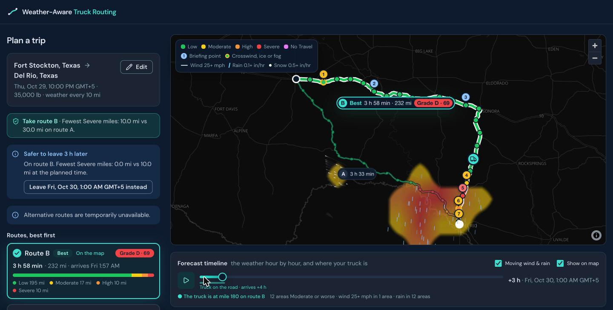
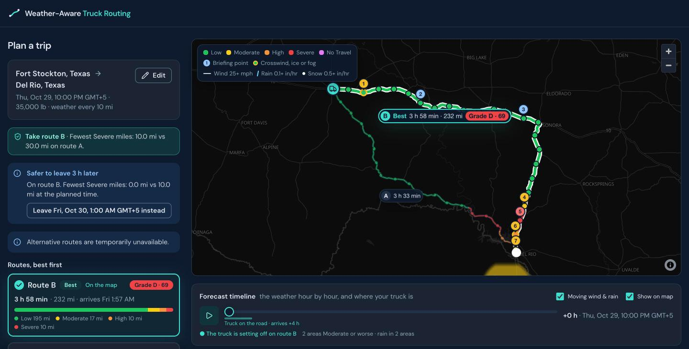
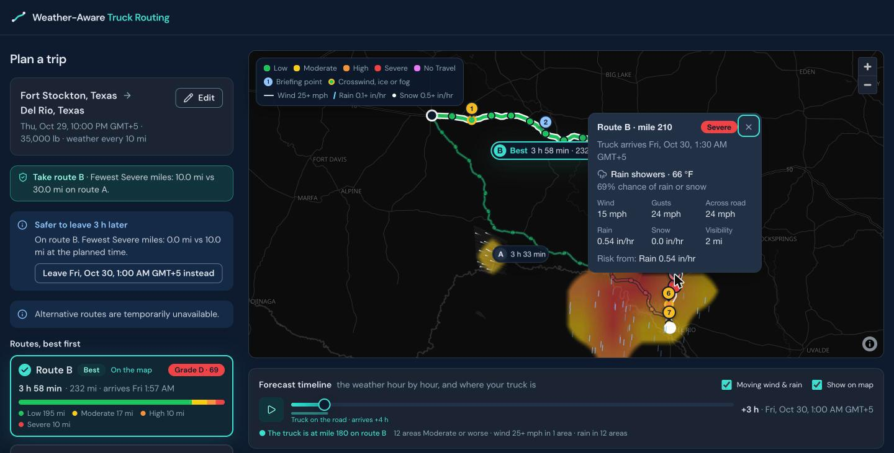
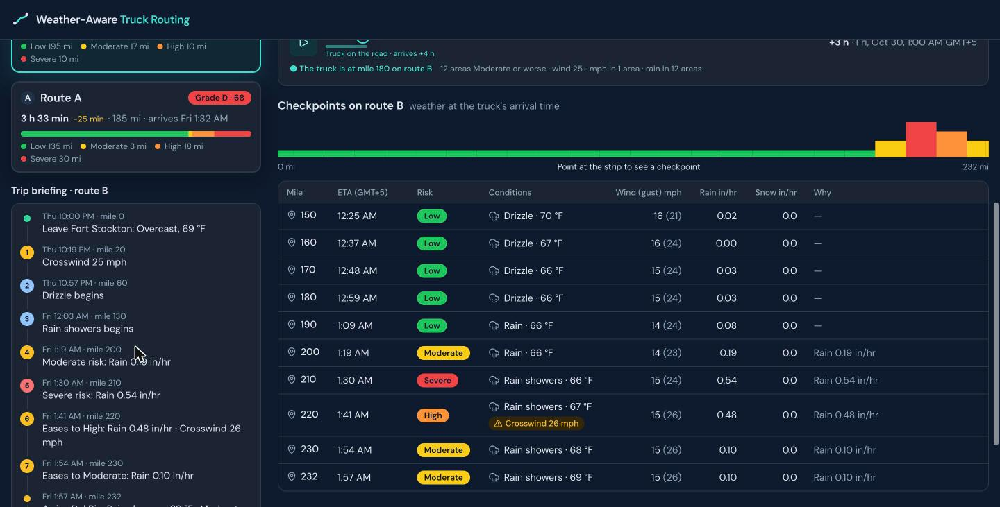
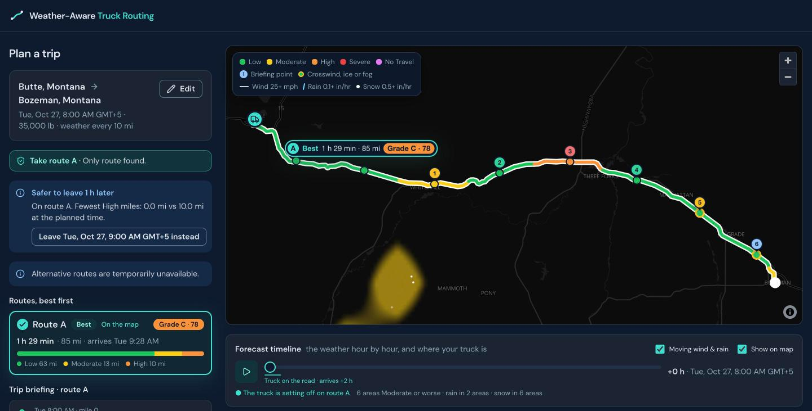
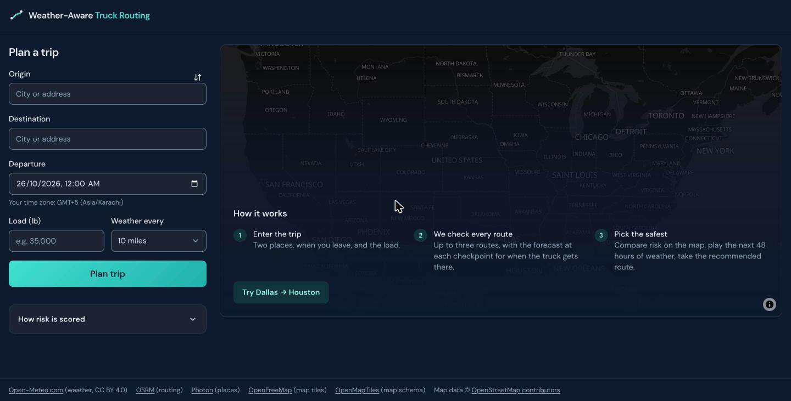
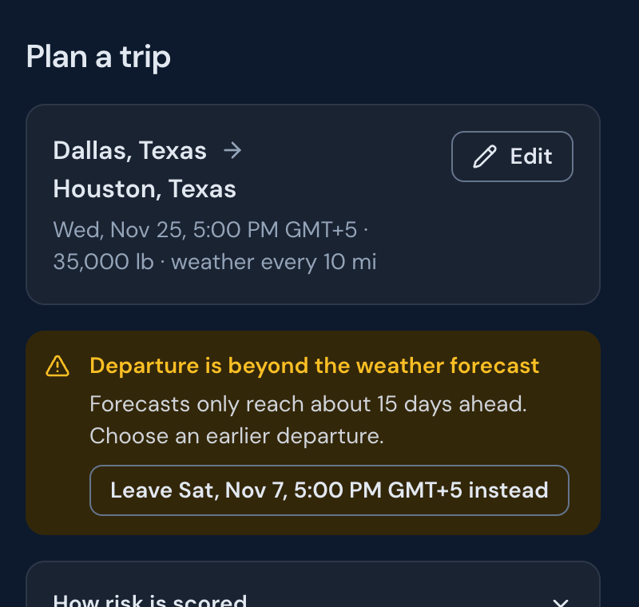
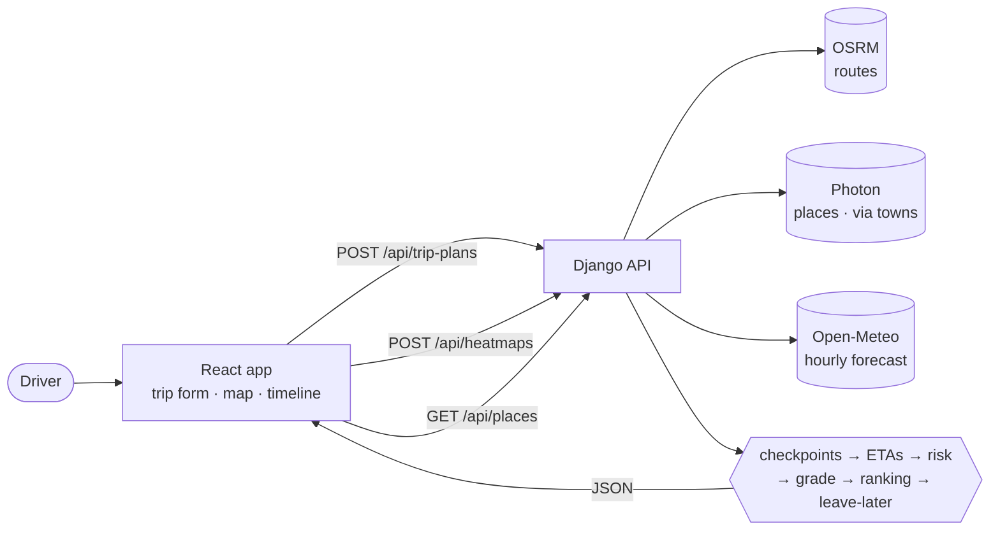
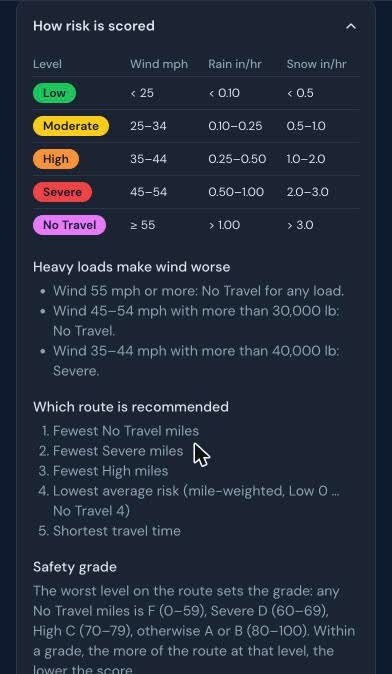

<div align="center">

# 🚚 Weather-Aware Truck Routing

**Pick the safest route by the weather the truck will actually drive into, not just the fastest one.**

[](https://github.com/Rizu0007/weather-aware-truck-routing/actions/workflows/ci.yml)


### [▶ Live demo](https://truck-weather-routing-chi.vercel.app)



</div>

The driver enters an origin, a destination, a departure time and the load. The app finds up to three
routes, checks the weather at points along each one **for the hour the truck will be there**, scores
the risk with the brief's rules, recommends a route, and shows it all on a map with a 0–48 h
weather heatmap.

## Contents

- [Why](#why)
- [Features](#features)
- [Screenshots](#screenshots)
- [How it works](#how-it-works)
- [Risk rules](#risk-rules)
- [Tech stack](#tech-stack)
- [Getting started](#getting-started)
- [Deployment](#deployment)
- [API](#api)
- [Testing](#testing)
- [Living with free public services](#living-with-free-public-services)
- [Assumptions](#assumptions)
- [Data credits](#data-credits)

## Why

Route planners answer "what's fastest?". A truck driver also needs to know **what the weather will be
at each part of the road when the truck gets there**. A storm 200 miles ahead matters only if it's
still there in three hours. Heavy loads make strong wind far more dangerous. This app turns the
forecast into one clear decision: **which route, and when to leave**.

## Features

| | |
|---|---|
| 🛣️ **Up to 3 routes, ranked** | Best first, with a one-line reason ("Fewest Severe miles: 10.0 mi vs 30.0 mi on route A") and what the pick avoids ("Avoids rain 0.42 in/hr on route A at mile 220"). |
| ⏱️ **Weather at the truck's ETA** | A checkpoint every 10, 25 or 50 miles, each with the forecast for the hour the truck arrives. |
| 🚦 **Risk per checkpoint** | Low → No Travel from the wind, rain and snow thresholds, plus the **load rules**: heavy loads make wind worse. |
| 🅰️ **Safety grade** | A 0–100 score and A–F grade per route, so routes compare at a glance. |
| 🕒 **Best time to leave** | Re-scores the next 24 hourly departures. "Safer to leave 3 h later", and one click plans again. |
| 🗺️ **Risk map** | Routes coloured by risk, a truck that drives along the route, and a popup at every checkpoint. |
| 🌧️ **Forecast timeline** | A 0–48 h heatmap around the routes with playback. Animated white wind streamlines, blue rain streaks and drifting snow, only where they raise risk. |
| 📝 **Trip briefing** | What changes along the route, in driving order ("1:30 AM · mile 210 · Severe risk: Rain 0.54 in/hr"). |
| 🌫️ **Driving conditions** | Shown, never scored: sky, temperature, gusts, visibility and **crosswind** (from the wind direction and the road's heading), with flags for crosswind, ice and fog. |
| 📋 **Checkpoint table** | The map in text, linked both ways, with a "Why" column. It's also the accessible version of the map. |
| 🔗 **Shareable trips** | The whole trip lives in the URL: it survives a refresh and can be sent to a driver. |
| 🛟 **Honest errors** | No road route, beyond the forecast (with a one-click earlier departure), rate limits with a countdown, and a sleeping server that wakes up and retries by itself. |

## Screenshots

<table>
  <tr>
    <td width="50%"><br><sub><b>Safety before speed.</b> Route A is 25 min faster but ends in Severe rain, so B is recommended, with a "leave 3 h later" suggestion.</sub></td>
    <td width="50%"><br><sub><b>Checkpoint popup.</b> The forecast at the truck's ETA and the reason for its risk level.</sub></td>
  </tr>
  <tr>
    <td width="50%"><br><sub><b>Trip briefing and checkpoint table.</b> Where it gets worse, where it eases, and why.</sub></td>
    <td width="50%"><br><sub><b>Snow.</b> A High section near Three Forks, Montana: grade C, and leaving 1 h later avoids it.</sub></td>
  </tr>
  <tr>
    <td width="50%"><br><sub><b>Start.</b> Two places, when you leave, and the load.</sub></td>
    <td width="50%"><br><sub><b>Helpful errors.</b> Too far ahead? One click picks the latest departure that works.</sub></td>
  </tr>
</table>

## How it works



1. **Routes.** OSRM's public server usually returns only 1–2 routes. For the missing ones the backend
   forces a route through the **nearest town** to a point beside the direct line (towns sit on
   through-roads; raw offset points snap to dirt roads). A candidate is dropped if more than 80 % of
   it overlaps a route already kept, or if it takes more than 1.5× the fastest. Towns in a country
   neither end is in are skipped (no detours through Mexico on a US trip). Corridors with one
   sensible road return fewer routes, with a warning.
2. **Checkpoints and ETAs.** A checkpoint every N miles plus the destination. Drive time comes from
   OSRM's per-segment durations, scaled to its route total and capped at 65 mph.
3. **Weather.** One batched Open-Meteo request for every checkpoint of every route, read at the
   forecast hour nearest each ETA.
4. **Risk.** Worst of wind (after the load rules), rain and snow. Each checkpoint stands for the road
   half-way to its neighbours, so risk miles add up to the route length.
5. **Ranking.** Fewest No Travel miles, then Severe, then High, then the mile-weighted average risk
   (Low 0 … No Travel 4), then travel time. Differences under 0.1 mi or 0.01 risk count as ties.
6. **Safety grade.** The worst level on the route sets the band, as it leads the ranking: any No
   Travel miles is F (0–59), Severe D (60–69), High C (70–79), otherwise A or B (80–100). The share of
   the route at that level sets the score within the band.
7. **Later departures.** The forecast is fetched 24 h longer, and each hourly departure is re-scored
   from it, with no extra requests. The earliest departure with the fewest No Travel, Severe and High
   miles is suggested if it beats the planned one; less Moderate or a shorter drive alone isn't.
8. **Heatmap.** A grid of up to 120 cells 50 km either side of the routes, 49 hourly risk levels and
   winds each, loaded once. Each hour is a small image (one pixel per cell, scaled up smoothly with a
   sharp edge), so the slider only redraws ~100 pixels and never calls the server.

The browser only calls `/api/...` on its own origin; Vite (dev), nginx (Docker) or the `vercel.json`
service routing (production) sends it to Django. No CORS, and no API URL or key ever reaches the browser.

## Risk rules

<table>
  <tr>
    <td width="40%"></td>
    <td>

| Level | Wind mph | Rain in/hr | Snow in/hr |
|---|---|---|---|
| 🟢 Low | < 25 | < 0.10 | < 0.5 |
| 🟡 Moderate | 25–34 | 0.10–0.25 | 0.5–1.0 |
| 🟠 High | 35–44 | 0.25–0.50 | 1.0–2.0 |
| 🔴 Severe | 45–54 | 0.50–1.00 | 2.0–3.0 |
| 🟣 No Travel | ≥ 55 | > 1.00 | > 3.0 |

**Heavy loads make wind worse**

- Wind 55 mph or more: No Travel for any load.
- Wind 45–54 mph with more than 30,000 lb: No Travel.
- Wind 35–44 mph with more than 40,000 lb: Severe.

The same rules are in the app, under **How risk is scored**.

</td>
  </tr>
</table>

## Tech stack

| | |
|---|---|
| Backend | Django 5.2 LTS, Django REST Framework, `requests`; uv, Ruff, pytest |
| Frontend | React 19, Vite 8, TypeScript, React Router 8, TanStack Query, Tailwind CSS 4, MapLibre GL |
| Map tiles | OpenFreeMap (dark style) |
| Hosting | Vercel: one project, two services (`vercel.json`), the frontend at `/` and Django at `/api` |

```text
backend/trips/
  api/            serializers, views, error handler
  services/       trip_planning, route_options, heatmap, forecast_window
  domain/         pure logic: risk, checkpoints, geo, ranking, alternatives, corridor
  integrations/   http (timeouts, retries), osrm, photon, open_meteo
frontend/src/
  components/ui/        Button, Combobox, Slider, …
  components/features/  trip-form, results, map, heatmap
  hooks/  api/  pages/  routes/  utils/  styles/tokens.css
```

## Getting started

Requirements: Python 3.12, [uv](https://docs.astral.sh/uv/), Node.js 24 (22.22+ works).

```bash
# Backend: http://127.0.0.1:8000/api/health
cd backend
cp .env.example .env        # DJANGO_SECRET_KEY is required
uv sync
uv run python manage.py runserver

# Frontend: http://localhost:5173 (proxies /api to the backend)
cd frontend
npm ci
npm run dev
```

With Docker:

```bash
docker compose up -d --build                             # app :8080, API :8000
docker compose --profile test run --rm backend-tests     # backend lint + tests
docker compose --profile test run --rm frontend-tests    # frontend lint + types + tests
```

`backend/.venv/bin/pre-commit install` adds a Ruff hook for backend commits.

## Deployment

The app deploys to **Vercel as one project with two services**, defined in the root
[`vercel.json`](vercel.json): the Vite frontend at `/` and Django at `/api/...`, on one domain.

```bash
npx vercel login
npx vercel link
npx vercel --prod
```

Set these environment variables on the Vercel project (Production and Preview):

| Variable | Value |
|---|---|
| `DJANGO_SECRET_KEY` | A long random string |
| `DJANGO_DEBUG` | `False` |
| `DJANGO_ALLOWED_HOSTS` | `.vercel.app` (plus any custom domain) |
| `NUM_PROXIES` | `1`, so per-IP rate limits see the real client |

The backend's cache and rate limits are in memory, so on Vercel they're per function instance.

## API

| Endpoint | Returns |
|---|---|
| `GET /api/health` | `{"status": "ok"}` |
| `GET /api/places?q=Hous` | Up to 5 North American places: `[{label, lat, lon}]` |
| `POST /api/trip-plans` | Up to 3 ranked routes with checkpoints, weather at each ETA and risk summaries |
| `POST /api/heatmaps` | Hourly risk (0–48 h) for each grid cell along the routes |

```bash
curl -X POST https://truck-weather-routing-chi.vercel.app/api/trip-plans \
  -H 'Content-Type: application/json' -d '{
  "origin": {"lat": 32.7767, "lon": -96.797}, "destination": {"lat": 29.7604, "lon": -95.3698},
  "departure": "2026-10-28T14:00:00Z", "load_lb": 35000, "interval_mi": 10}'
```

Errors are always `{"message": str, "extra": {...}}`: 400 invalid input (`extra.fields`), 422 no road
route or beyond the forecast (`extra.latest_departure`), 429 too many requests, 502 a provider
failed, 503 a provider is rate-limited (`extra.retry_after`).

`scripts/` holds the probe and tuning scripts used to measure the providers and pick the thresholds
above (standard library only, e.g. `python3 scripts/probe_osrm.py`).

## Testing

| Layer | What | Command |
|---|---|---|
| Backend (269 tests) | Risk bands and load rules, checkpoints and ETAs, ranking, provider clients (mocked from real saved responses), every API error | `cd backend && uv run pytest` |
| Frontend (245 tests) | UI components, hooks, API client errors, pages, map/table wiring, WCAG contrast of the colour tokens | `cd frontend && npm test` |
| Time zones | The time suite under New York, Chicago, Los Angeles, London, Karachi and Kolkata, including the UK (25 Oct) and US (1 Nov) daylight-saving changes | `cd frontend && npm run test:zones` |
| CI | All of the above plus lint, format, type check and build on every push | `.github/workflows/ci.yml` |

Frontend tests use real responses captured from the backend in `frontend/src/test/fixtures/`; a test
fails if they stop matching `src/types/api.ts`. Regenerate them after changing a serializer:
`cd backend && uv run python -m tests.capture_frontend_fixtures`.

Each step was also checked end to end in a real Chrome, against a mock API and the real services:
the user flow, map and heatmap (48 hours scrubbed with 0 long tasks and 0 requests), every error and
loading state, a cold start, and time zones (a UK browser shows "14:00 BST").

## Living with free public services

| Service | Limit we hit | What the app does |
|---|---|---|
| OSRM demo | 1–2 routes; ~1 request/s policy; occasional 10 s+ stalls | Town via-points (above); a 20 s budget for alternatives, then plan with what was found |
| Photon | Results are global; typos rank streets first ("Maimi" → Maimi Circle); occasional stalls and hours-long outages | North America bounding box; towns before streets unless the query has a number; town lookups in parallel, capped at 8 s; after a failure, Photon is skipped for 60 s (place search falls back to Open-Meteo geocoding, plans go ahead without via-town alternatives) |
| Open-Meteo | ~600 locations/min for all users; ~15 days ahead; a heavy caller is slowed to ~0.45 s per location, and 4 parallel requests get 503s | Batches of 50, 2 at a time, read timeout grown with batch size (up to 45 s), 15-min cache, a plan ≤ 240 checkpoints (spacing widened on long trips), heatmap ≤ 120 cells, a 429 becomes "busy, retry in N s" |

Repeat plans are served from the backend cache in ~0.1 s. The UI says "Still working…" after 10 s
and waits up to 90 s.

## Assumptions

Where the brief left room:

- Bands include their lower bound (25 mph is Moderate); No Travel follows the table literally, so
  exactly 1.00 in/hr rain is still Severe.
- No Travel miles rank first, ahead of Severe miles.
- Wind is the sustained 10 m wind speed, not gusts. Crosswind, shown but not scored, uses gusts.
- Drive times are a car profile capped at 65 mph, without rest breaks (OSRM's demo server has no
  truck profile).
- Departures must leave room in the ~15-day forecast; the heatmap hours count from departure.
- All times are shown in the browser's own time zone and language; the API works in UTC.

## Data credits

Weather by [Open-Meteo.com](https://open-meteo.com/) (CC BY 4.0). Routing by
[OSRM](https://project-osrm.org/), places by [Photon](https://photon.komoot.io/), map tiles by
[OpenFreeMap](https://openfreemap.org/) and [OpenMapTiles](https://openmaptiles.org/). Map data ©
[OpenStreetMap contributors](https://www.openstreetmap.org/copyright).
