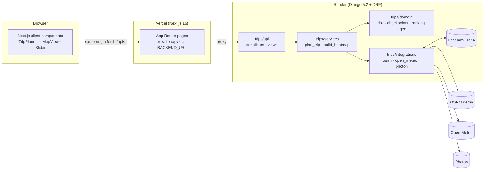
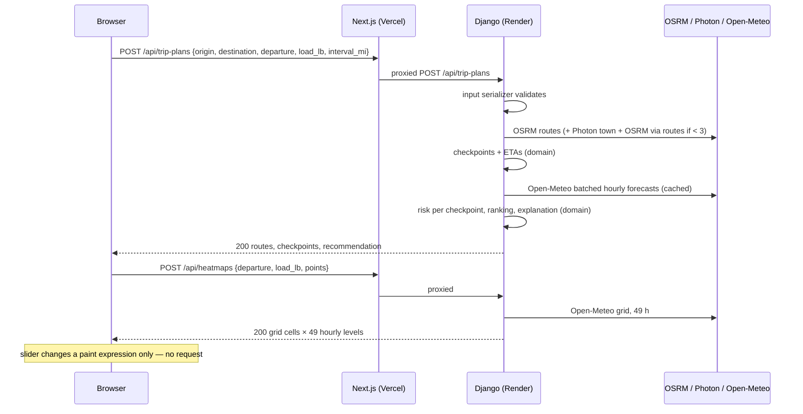

# Research — Django + Next.js setup

Research done 2026-10-18. Versions come from the live PyPI / npm / GitHub registries on that date
(commands in the appendix). Every recommendation links its source; anything without a source is
marked **UNVERIFIED**. Things judged too heavy for an assessment are marked **OVERKILL**.

## 1. Recommended approach (summary)

1. **Two deployables:** Next.js frontend on Vercel, Django API on Render. The browser only ever talks
   to the Next.js origin; Next.js [rewrites](https://nextjs.org/docs/app/api-reference/config/next-config-js/rewrites)
   proxy `/api/*` to Django. Same origin means **no CORS**, and the Django URL stays server-side.
2. **No secrets reach the browser:** no `NEXT_PUBLIC_*` variables are needed at all. External API
   access (OSRM, Open-Meteo, Photon) happens only in Django ([Next.js env docs](https://nextjs.org/docs/app/guides/environment-variables)).
3. **Django 5.2 LTS + DRF 3.18**, not 6.1: 5.2 is the only series every package in our stack
   officially supports, and it is supported until April 2028 ([Django download page](https://www.djangoproject.com/download/)). See §10.
4. **Thin API, logic in plain modules:** HackSoft style ([Django Styleguide](https://github.com/HackSoftware/Django-Styleguide)).
   Views validate input and call one service; third-party HTTP clients live in their own
   `integrations/` package; pure domain logic (risk rules, geometry) has no Django imports.
5. **One env-driven settings file** via `django-environ`, plus `.env.example`. A
   base/local/production split is **OVERKILL** for a stateless API with ~20 settings (§2.2).
6. **Next.js 16 App Router, client-heavy page:** the page shell is a Server Component; the
   interactive planner (form, map, slider) is one Client Component tree. The map loads browser-only
   via `next/dynamic` with `ssr: false` ([SPA guide](https://nextjs.org/docs/app/guides/single-page-applications)).
7. **MapLibre GL JS used directly** (no React wrapper) so the heatmap slider can call
   `setPaintProperty` without React re-renders.
8. **Testing:** pytest + pytest-django + `responses` (HTTP mocks fed by `scripts/samples/`);
   Vitest + React Testing Library on the frontend, as the Next.js docs set it up.
9. **Tooling:** Ruff (lint + format), ESLint 9 flat config + Prettier, pre-commit, and one GitHub
   Actions workflow with a backend job and a frontend job.
10. **No Docker:** both hosts build from source natively, and there's no database or other service
    to compose (§7.4).

---

## 2. Django

### 2.1 Folder tree

```text
backend/
├── pyproject.toml             deps + dev group, ruff + pytest config
├── uv.lock                    committed; Render enables uv when this file exists
├── .python-version            3.12
├── .env.example
├── manage.py
├── config/
│   ├── settings.py            single env-driven settings module
│   ├── urls.py                /api/ → trips.api.urls
│   └── wsgi.py
├── trips/                     the one Django app (domain: trip planning)
│   ├── apps.py
│   ├── api/                   HTTP layer only
│   │   ├── serializers.py     input + output serializers (plain Serializer, not ModelSerializer)
│   │   ├── views.py           TripPlanCreateApi, HeatmapCreateApi, PlaceSearchApi, HealthApi
│   │   ├── exception_handler.py
│   │   └── urls.py
│   ├── services/              use-case orchestration (what a view calls)
│   │   ├── trip_planning.py   plan_trip(...)
│   │   └── heatmap.py         build_heatmap(...)
│   ├── domain/                pure Python, no Django/HTTP imports — easiest to unit-test
│   │   ├── risk.py            threshold table + load rules
│   │   ├── geo.py             distance, interpolation, slicing, simplification
│   │   ├── checkpoints.py     sampling + ETA
│   │   └── ranking.py         route summaries + recommendation
│   ├── integrations/          one module per external API: HTTP, retries, response normalisation
│   │   ├── http.py            shared session, timeouts, retry policy
│   │   ├── osrm.py
│   │   ├── open_meteo.py
│   │   └── photon.py
│   └── exceptions.py          ApplicationError hierarchy (ProviderError, NoRouteError, …)
└── tests/
    ├── conftest.py            fixture loaders for scripts/samples/*
    ├── fixtures/              trimmed copies of the samples the tests need
    ├── domain/  integrations/  services/  api/
```

Why this shape:

- **Project vs app:** Django's model is one project (`config/`) and apps for domains. We have one
  domain, so one app. A HackSoft-style `apps/` or `styleguide_example/` wrapper package
  ([Styleguide-Example](https://github.com/HackSoftware/Styleguide-Example)) would hold a single
  app here: **OVERKILL**.
- **Services:** HackSoft puts business logic in services/selectors, not in views, serializers, or
  `save()`, and APIs should be "an interface to the core logic"
  ([Styleguide](https://github.com/HackSoftware/Django-Styleguide)). We have no models and so no
  selectors, which in HackSoft's terms are database reads. **Selectors are skipped.**
- **`domain/`:** our choice, not a HackSoft term. It keeps the rules worth 40 % of the grade free of
  Django so they're tested as plain functions. **UNVERIFIED as a community convention**; justified
  by testability.
- **`integrations/`:** HackSoft names integration *settings* `config/settings/<integration>.py`, but
  the fetched page doesn't define a folder for client code
  ([Styleguide](https://github.com/HackSoftware/Django-Styleguide)). The folder name is our choice:
  **UNVERIFIED as a convention**.
- **API classes:** one API per operation, `APIView` base, named `<Entity><Action>Api`, with separate
  input and output serializers ([Styleguide](https://github.com/HackSoftware/Django-Styleguide)).
- **`utils.py`:** deliberately absent. Helpers live next to the code that uses them (`domain/geo.py`,
  `integrations/http.py`).

### 2.2 Settings and env

- **`django-environ` 0.14.0** ([quickstart](https://django-environ.readthedocs.io/en/latest/quickstart.html)):
  `env = environ.Env(DEBUG=(bool, False))`, `environ.Env.read_env(BASE_DIR / ".env")`, and
  `env("DJANGO_SECRET_KEY")`, which raises `ImproperlyConfigured` when missing. HackSoft uses the
  same library ([Styleguide](https://github.com/HackSoftware/Django-Styleguide)).
- **Secrets:** never committed; loaded from the environment, as Django's deployment checklist
  recommends ("avoid committing it to source control … loading it from an environment variable",
  [checklist](https://docs.djangoproject.com/en/5.2/howto/deployment/checklist/)). `.env` is
  git-ignored and `.env.example` is committed (HackSoft). django-environ's own docs call the
  template `.env.dist`; we use `.env.example`, which the brief asked for.
- **One file vs split:** HackSoft uses `config/django/{base,local,production,test}.py` but also says
  "There should be nothing that's only included in `production.py`" and controls production
  behaviour through env vars ([Styleguide](https://github.com/HackSoftware/Django-Styleguide)). With
  no database, cache server, or email, all the differences are env values, so we use **one
  `settings.py`**. Tests override per test with the pytest-django `settings` fixture
  ([helpers](https://pytest-django.readthedocs.io/en/latest/helpers.html)).
- **Production checklist items that apply** ([checklist](https://docs.djangoproject.com/en/5.2/howto/deployment/checklist/)):
  `DEBUG=False`, `ALLOWED_HOSTS`, a strong `SECRET_KEY`, and a reviewed `LOGGING`. `STATIC_ROOT`,
  databases and sessions don't apply: there's no admin and no static files.

Backend variables:

| Variable | Required | Notes |
|---|---|---|
| `DJANGO_SECRET_KEY` | prod | Random value, Render secret |
| `DJANGO_DEBUG` | no | Defaults to `False` |
| `DJANGO_ALLOWED_HOSTS` | prod | Render hostname |
| `OSRM_URL`, `OPEN_METEO_URL`, `PHOTON_URL` | no | Defaults to the public endpoints |
| `OPEN_METEO_API_KEY` | no | Switches to the `customer-` host ([Open-Meteo docs](https://open-meteo.com/en/docs)) |

### 2.3 Errors, logging, CORS, caching

- **Errors:** a custom DRF `EXCEPTION_HANDLER` that wraps DRF's default
  ([DRF exceptions](https://www.django-rest-framework.org/api-guide/exceptions/)). Domain errors
  subclass one `ApplicationError` and map to one response shape `{ "message": str, "extra": {} }`, as
  HackSoft proposes ([Styleguide](https://github.com/HackSoftware/Django-Styleguide)). Status codes:
  validation 400, no route or forecast horizon 422, provider failure 502.
- **Logging:** Django `LOGGING` dict with a console handler. Render captures stdout. Each provider
  call logs duration, status and batch size; nothing secret.
- **CORS:** not needed. The browser calls the Next.js origin and Next.js proxies to Django.
  `django-cors-headers` is **dropped**; it also only declares support up to Django 6.0 (PyPI
  classifiers).
- **Caching external calls:** Django's low-level cache API (`get_many`/`set_many`) on
  **LocMemCache**. Django's docs say it is per-process, "not particularly memory-efficient … nice for
  development" ([cache docs](https://docs.djangoproject.com/en/5.2/topics/cache/)). That's
  acceptable here: losing cache entries only costs extra API calls. Redis would be **OVERKILL** for an
  assessment; it's noted as the production upgrade.

---

## 3. Next.js

### 3.1 Folder tree

```text
frontend/
├── package.json  package-lock.json  tsconfig.json
├── next.config.ts            rewrites /api/:path* → ${BACKEND_URL}/api/:path*
├── eslint.config.mjs  .prettierrc.json  vitest.config.mts
├── .env.example              BACKEND_URL=http://127.0.0.1:8000
└── src/
    ├── app/
    │   ├── layout.tsx         root layout (Server Component), attribution footer
    │   ├── page.tsx           Server Component shell → <TripPlanner/>
    │   ├── error.tsx          route error boundary
    │   └── globals.css
    ├── components/
    │   ├── trip-planner/      trip-planner.tsx ('use client'), trip-form.tsx, place-input.tsx
    │   ├── routes/            route-list.tsx, route-card.tsx, risk-strip.tsx
    │   ├── map/               map-view.tsx (browser-only), layers.ts, heatmap-layer.ts, checkpoint-popup.tsx
    │   └── heatmap/           heatmap-controls.tsx, legend.tsx
    ├── hooks/                 use-trip-plan.ts, use-heatmap.ts, use-place-search.ts
    ├── lib/
    │   ├── api/client.ts      fetch wrapper: JSON, timeout, error → ApiError
    │   ├── api/endpoints.ts   planTrip(), fetchHeatmap(), searchPlaces()
    │   ├── risk.ts            level → label/colour
    │   └── format.ts          miles, durations, times
    └── types/api.ts           response types mirroring the Django output serializers
```

- **`src/`:** optional; the docs say it "separates application code from project configuration
  files", and `.env*` files stay in the project root
  ([project structure](https://nextjs.org/docs/app/getting-started/project-structure),
  [env docs](https://nextjs.org/docs/app/guides/environment-variables)).
- **Shared folders outside `app/`:** this is one of the three documented strategies ("store project
  files outside of app"). Next.js is "unopinionated" about which; `components`/`lib`/`hooks` names
  carry "no special framework significance"
  ([project structure](https://nextjs.org/docs/app/getting-started/project-structure)).
- **No `loading.tsx`:** the page doesn't fetch on the server, so there's nothing to stream. Loading
  states are component state during user-triggered requests.
- **`'use client'` as low as possible:** the docs recommend marking only interactive files, because
  "all of its imports … are included in the client bundle"
  ([server and client components](https://nextjs.org/docs/app/getting-started/server-and-client-components)).
  Here, almost the whole page is interactive, so the boundary is `trip-planner.tsx`.
- **Map:** MapLibre needs `window`/WebGL, so `map-view.tsx` is imported with
  `dynamic(() => import(...), { ssr: false })` ([SPA guide](https://nextjs.org/docs/app/guides/single-page-applications)).
  MapLibre v6 needs its worker URL set; the documented Next.js/Turbopack pattern is
  `new URL('maplibre-gl/dist/maplibre-gl-worker.mjs', import.meta.url)` and requires Next.js ≥ 15
  ([MapLibre docs](https://maplibre.org/maplibre-gl-js/docs/)). **We haven't tested it yet**; it's
  the first thing C9 checks.
- **create-next-app flags:** `--ts --eslint --tailwind --src-dir --app --use-npm --no-react-compiler
  --no-cache-components` ([CLI reference](https://nextjs.org/docs/app/api-reference/cli/create-next-app)).
  Cache Components is on by default and "can surface build errors for uncached data outside of
  `<Suspense>`" ([v16 upgrade guide](https://nextjs.org/docs/app/guides/upgrading/version-16)). We
  do no server data fetching, so it would add complexity for nothing.

### 3.2 Env approach

- Non-prefixed variables are server-only. `NEXT_PUBLIC_*` values are inlined into the browser bundle
  at build time ([env docs](https://nextjs.org/docs/app/guides/environment-variables)).
- The frontend needs exactly one variable, **`BACKEND_URL`** (server-only, used in
  `next.config.ts` rewrites). It holds no secret, and **no `NEXT_PUBLIC_` variable is needed**.
- `.env*` files are not committed (create-next-app git-ignores them); `.env.example` is.
- **UNVERIFIED:** whether Vercel evaluates `rewrites()` (and so `BACKEND_URL`) at build time or at
  runtime. Plan: set it in Vercel project env for both, and confirm after the first deploy.

### 3.3 Data fetching

- Every request is user-triggered (submit the form, type in autocomplete), so the work happens in
  **Client Components with `fetch`**. Next.js documents `use()` for server-started promises, and
  SWR/React Query "for focus revalidation, polling, mutations, or request deduplication"
  ([fetching data](https://nextjs.org/docs/app/getting-started/fetching-data),
  [SPA guide](https://nextjs.org/docs/app/guides/single-page-applications)). We need none of those,
  so **SWR and React Query are OVERKILL** here; a small hook with `AbortController` covers stale
  autocomplete responses.
- **Calls go to relative `/api/...`**, which the Next.js rewrite proxies to Django. Rewrites are
  checked after headers/redirects/proxy and pages
  ([rewrites](https://nextjs.org/docs/app/api-reference/config/next-config-js/rewrites)). Our `/api`
  prefix has no Next.js routes, so there's no clash.
- **Static export was rejected** even though it would allow one deployable: rewrites are on its
  "Unsupported Features" list ([static exports](https://nextjs.org/docs/app/guides/static-exports)),
  so the browser would call Django cross-origin and need CORS.
- **Loading/error states:** each hook exposes `status: 'idle' | 'loading' | 'success' | 'error'` and
  an `ApiError` carrying the backend `message`. `app/error.tsx` catches unexpected render errors.

### 3.4 TypeScript, ESLint, Prettier

- **ESLint:** flat `eslint.config.mjs` with `eslint-config-next/core-web-vitals`,
  `eslint-config-next/typescript` and `eslint-config-prettier/flat`, run with `eslint .`. `next lint`
  was **removed in Next.js 16** ([ESLint docs](https://nextjs.org/docs/app/api-reference/config/eslint)).
- **Prettier:** with `eslint-config-prettier` so the two don't fight
  ([ESLint docs](https://nextjs.org/docs/app/api-reference/config/eslint)), plus
  `prettier-plugin-tailwindcss` for class ordering.
- **TypeScript 6.0.3**, not 7: see conflict C1 (§10).
- **Type check in CI with `tsc --noEmit`**, which the docs recommend for CI
  ([TypeScript docs](https://nextjs.org/docs/app/api-reference/config/typescript)).

---

## 4. Architecture and request flow



Request sequence for a plan:



---

## 5. Naming conventions

| Area | Convention | Source |
|---|---|---|
| Python modules, functions, variables | `snake_case`; classes `PascalCase`; constants `UPPER_SNAKE` | [PEP 8](https://peps.python.org/pep-0008/) |
| DRF API classes | `<Entity><Action>Api`, e.g. `TripPlanCreateApi` | [HackSoft](https://github.com/HackSoftware/Django-Styleguide) |
| Serializers | `TripPlanInputSerializer`, `TripPlanOutputSerializer` | [HackSoft](https://github.com/HackSoftware/Django-Styleguide) (separate input/output) |
| Service functions | verb-first, keyword-only args: `plan_trip(*, origin, …)` | [HackSoft](https://github.com/HackSoftware/Django-Styleguide) |
| Tests | `test_<thing>.py`, functions `test_<behaviour>` | [HackSoft](https://github.com/HackSoftware/Django-Styleguide), pytest default discovery |
| React components | `PascalCase` identifiers | [React docs](https://react.dev/learn/your-first-component) (components must start with a capital letter) |
| Hooks | `useSomething` | [React docs](https://react.dev/reference/rules/rules-of-hooks) |
| TS/React file names | `kebab-case.tsx` (e.g. `like-button.tsx`, as in the Next.js docs examples) | [Next.js docs](https://nextjs.org/docs/app/getting-started/server-and-client-components) (example convention, not a rule) |
| TS variables/functions | `camelCase`; types/interfaces `PascalCase` | **UNVERIFIED** (common TS practice, no single official style guide) |
| Endpoints | `/api/<plural-noun>`, lowercase, kebab-case: `POST /api/trip-plans`, `POST /api/heatmaps`, `GET /api/places?q=`, `GET /api/health` | **UNVERIFIED** (common REST practice) |
| JSON fields | `snake_case` end to end (DRF default); TS types mirror it, so there's no mapping layer | Our choice |
| Env vars | `UPPER_SNAKE`, Django ones prefixed `DJANGO_` | Our choice |

API versioning (`/api/v1/`) is **OVERKILL**: one client, one deploy.

---

## 6. Testing

### 6.1 Backend: pytest + pytest-django + responses

- **pytest-django** config in `pyproject.toml` under `[tool.pytest.ini_options]` with
  `DJANGO_SETTINGS_MODULE = "config.settings"`
  ([tutorial](https://pytest-django.readthedocs.io/en/latest/tutorial.html)). The `settings` and
  `client` fixtures come built in; database access needs `django_db`, which we never need
  ([helpers](https://pytest-django.readthedocs.io/en/latest/helpers.html)). Chosen over Django's
  runner for fixtures, parametrisation (band-edge tables), and readable asserts. HackSoft's example
  repo uses pytest too ([Styleguide-Example](https://github.com/HackSoftware/Styleguide-Example)).
- **Mocking external APIs:** `responses` intercepts `requests`:
  `responses.get(url, json=..., status=...)`, `matchers.query_param_matcher` to assert params, and
  `body=requests.Timeout(...)` for timeouts ([responses README](https://github.com/getsentry/responses)).
  HackSoft: "mock … anything that leaves the project"
  ([Styleguide](https://github.com/HackSoftware/Django-Styleguide)).
- **Fixtures from `scripts/samples/`:** copy the needed samples into `backend/tests/fixtures/`, so the
  backend test suite is self-contained and the probe scripts can be rerun without breaking tests. A
  `load_sample(name)` helper lives in `conftest.py`.
- **factory_boy: OVERKILL.** There are no models. Plain dataclass builders cover test data.

| Layer | What we test | Mocks |
|---|---|---|
| `domain/` | Every band edge, load rules, checkpoint counts/coverage/ETA, ranking order and ties | none |
| `integrations/` | Request params, object-vs-array normalisation, 400/414/429/timeout handling, retries, cache hits | `responses` + samples |
| `services/` | Alternative-route filtering, < 3 routes path, horizon check, end-to-end plan shape | `responses` + samples |
| `api/` | Validation errors, status codes, response schema | services mocked or `responses` |

### 6.2 Frontend: Vitest + React Testing Library

- The Next.js docs' **Vitest** guide installs `vitest @vitejs/plugin-react jsdom
  @testing-library/react @testing-library/dom vite-tsconfig-paths`, with `environment: 'jsdom'`
  ([Vitest guide](https://nextjs.org/docs/app/guides/testing/vitest)). Vitest is picked over Jest
  because it needs no Babel/SWC transform setup. Both are documented
  ([testing overview](https://nextjs.org/docs/app/guides/testing)).
- **Limitation:** "Vitest currently does not support" async Server Components
  ([Vitest guide](https://nextjs.org/docs/app/guides/testing/vitest)). We have none worth testing.
- **What to test:** `lib/format.ts`, `lib/risk.ts`, `lib/api/client.ts` (error mapping with mocked
  `fetch`), `trip-form` validation, and `route-card` rendering from a fixture plan. MapLibre needs
  WebGL, which jsdom lacks, so `map-view` is mocked in component tests.
- **Fixtures:** frontend fixtures are **our own API's** responses (not the third-party samples),
  saved from a backend test run into `frontend/src/test/fixtures/`.
- **Playwright** (1.64.1) is documented for E2E ([testing overview](https://nextjs.org/docs/app/guides/testing)).
  A single smoke test (plan a trip, see 1–3 routes, move the slider) would be valuable, but needs a
  running backend in CI: **optional**, open question Q4.
- **MSW: OVERKILL.** A `vi.fn()` `fetch` stub is enough for one API client.

---

## 7. Tooling and CI

### 7.1 Python: Ruff for lint and format
- Ruff's formatter is "designed as a drop-in replacement for Black" with "> 99.9 % of lines …
  formatted identically" on Django and Zulip ([Ruff formatter](https://docs.astral.sh/ruff/formatter/)).
  One tool replaces Black + flake8 + isort. HackSoft's example repo uses Ruff
  ([Styleguide-Example](https://github.com/HackSoftware/Styleguide-Example)).
- Config in `pyproject.toml`: `[tool.ruff] line-length = 100`, `target-version = "py312"`,
  `[tool.ruff.lint] select = ["E", "F", "I", "B", "UP", "DJ"]`
  ([Ruff configuration](https://docs.astral.sh/ruff/configuration/)). The rule selection is our
  choice.
- **mypy + django-stubs: OVERKILL** for this size (HackSoft uses it). Type hints are still written.

### 7.2 Python packaging: uv
- `pyproject.toml` + `uv.lock`, with `uv sync --locked` in CI ([uv GitHub guide](https://docs.astral.sh/uv/guides/integration/github/)).
- Render enables uv when `uv.lock` is in the service root, and its build command can use `uv sync`
  ([Render changelog](https://render.com/changelog/added-uv-to-the-python-native-runtime),
  [troubleshooting](https://render.com/docs/troubleshooting-python-deploys)). Render's default uv is
  0.10.2, so set `UV_VERSION` to match the lockfile's ([uv version](https://render.com/docs/uv-version)).
  Python version comes from `.python-version` ([Render Python version](https://render.com/docs/python-version)).

### 7.3 Pre-commit
- `ruff-pre-commit` at `rev: v0.17.1`, hooks `ruff-check` (with `--fix`, before the formatter) and
  `ruff-format` ([ruff-pre-commit](https://github.com/astral-sh/ruff-pre-commit)).
- The Prettier mirror `pre-commit/mirrors-prettier` is **archived** (since Apr 2024)
  ([repo](https://github.com/pre-commit/mirrors-prettier)), so ESLint and Prettier run as
  `repo: local` hooks calling the project's own `npx` binaries. No husky/lint-staged, so there's one
  hook system.

### 7.4 GitHub Actions: `.github/workflows/ci.yml`

| Job | Steps |
|---|---|
| `backend` | `actions/checkout@v7` → `astral-sh/setup-uv@v10` (uv 0.13.1, cache on) → `uv python install` → `uv sync --locked` → `uv run ruff check` → `uv run ruff format --check` → `uv run pytest` |
| `frontend` | `actions/checkout@v7` → `actions/setup-node@v7` (Node 24, npm cache) → `npm ci` → `npx eslint .` → `npx prettier --check .` → `npx tsc --noEmit` → `npx vitest run` → `npx next build` |

Action versions from GitHub releases: checkout v7.0.1, setup-node v7.1.0, setup-uv v10.3.0. The uv
guide's example still shows setup-uv v9.0.0 ([uv GitHub guide](https://docs.astral.sh/uv/guides/integration/github/)),
so we use the newer release and pin to the major version.

### 7.5 Docker: not worth it here
- Vercel builds Next.js natively. Render builds Python natively with uv.
- There's no database, cache server or worker, so docker-compose would orchestrate just two
  processes we already run with two commands.
- A Dockerfile would add a third build path to maintain without fixing a real problem.
  **OVERKILL**; revisit if we leave Render/Vercel.

---

## 8. Exact packages and versions (registry data, 2026-10-18)

### Backend (PyPI)

| Package | Version | Role | Notes |
|---|---|---|---|
| Python | 3.12 | runtime | Django 5.2 supports 3.10–3.14; local is 3.12.13 |
| Django | **5.2.18** | framework | LTS, extended support to Apr 2028 ([download](https://www.djangoproject.com/download/)) |
| djangorestframework | 3.18.3 | API | Classifiers: Django 5.2, 6.0, 6.1 |
| django-environ | 0.14.0 | settings | Classifiers up to Django 6.0 |
| requests | 2.34.2 | HTTP client | |
| gunicorn | 26.2.0 | WSGI server | |
| pytest | 9.1.1 | dev | |
| pytest-django | 4.14.0 | dev | Official Django 6.0 support since 4.12; **no 6.1 mention** ([changelog](https://pytest-django.readthedocs.io/en/latest/changelog.html)) |
| responses | 0.26.3 | dev | |
| ruff | 0.17.1 | dev | |
| pre-commit | 4.7.0 | dev | Needs Python ≥ 3.11 |
| uv | 0.13.1 | tooling | |

Dropped from the earlier plan: `django-cors-headers` (same-origin) and `whitenoise` (Django no
longer serves the frontend or static files).

### Frontend (npm)

| Package | Version | Role | Notes |
|---|---|---|---|
| Node.js | 24 LTS (CI) | runtime | Next 16 needs ≥ 20.9; Vitest 5 and jsdom 30 need ≥ 22.12/22.22 |
| next | 16.4.2 | framework | |
| react / react-dom | 19.3.1 | UI | |
| typescript | **6.0.3** | types | Not 7.0.2: see C1 |
| @types/react | 19.3.0 | types | |
| @types/node | 26.6.5 | types | |
| maplibre-gl | 6.14.0 | map | Worker URL setup required in v6 |
| tailwindcss / @tailwindcss/postcss | 4.3.3 | styling | create-next-app default |
| eslint | **9.39.5** | lint | Not 10.13.0: see C2 |
| eslint-config-next | 16.4.2 | lint | |
| eslint-config-prettier | 10.1.8 | lint | |
| prettier | 3.9.10 | format | |
| prettier-plugin-tailwindcss | 0.8.1 | format | |
| vitest | 5.0.5 | test | |
| @vitejs/plugin-react | 6.1.2 | test | |
| vite-tsconfig-paths | 6.1.1 | test | |
| jsdom | 30.1.3 | test | |
| @testing-library/react | 16.3.3 | test | |
| @testing-library/dom | 10.4.2 | test | |
| @playwright/test | 1.64.1 | e2e | Optional (Q4) |

Considered and skipped: `react-map-gl` 8.1.3 (a declarative wrapper; we need imperative paint
updates), `swr` 2.5.1 / `@tanstack/react-query` 5.104.4 (no caching or revalidation needs), `msw`
3.0.3, `factory-boy` 3.3.3, `drf-spectacular` 0.30.0 (OpenAPI generation: OVERKILL for 4 endpoints).

---

## 9. Reference repos and articles

| Link | What we take | What we skip |
|---|---|---|
| [HackSoft Django Styleguide](https://github.com/HackSoftware/Django-Styleguide) | Services hold logic; thin `APIView`s; input/output serializers; `<Entity><Action>Api` naming; custom exception handler + `ApplicationError`; django-environ + `.env.example`; "mock anything that leaves the project" | Selectors (no DB), settings split, model rules, Celery |
| [HackSoft Styleguide-Example](https://github.com/HackSoftware/Styleguide-Example) | pytest, Ruff, pre-commit, GitHub Actions layout | mypy/django-stubs, docker-compose, JWT/sessions/files apps |
| [cookiecutter-django](https://github.com/cookiecutter/cookiecutter-django) | 12-factor env config via django-environ; pre-commit by default | Postgres, Docker/Traefik, Celery, the whole generated scaffold. The README shows a Black badge where we use Ruff |
| [Django deployment checklist](https://docs.djangoproject.com/en/5.2/howto/deployment/checklist/) | SECRET_KEY from env, DEBUG off, ALLOWED_HOSTS, logging review | Static/media/DB/session items (not applicable) |
| [DRF exceptions](https://www.django-rest-framework.org/api-guide/exceptions/) | `EXCEPTION_HANDLER`, `APIException` subclasses | — |
| [Django cache framework](https://docs.djangoproject.com/en/5.2/topics/cache/) | LocMemCache, `get_many`/`set_many` | Memcached/Redis (noted as upgrade path) |
| [Next.js project structure](https://nextjs.org/docs/app/getting-started/project-structure) | `src/`, shared folders outside `app/` | Route groups, parallel/intercepted routes |
| [Next.js env vars](https://nextjs.org/docs/app/guides/environment-variables) | Server-only by default; `NEXT_PUBLIC_` inlined; don't commit `.env*` | `@next/env` loader (not needed) |
| [Next.js fetching data](https://nextjs.org/docs/app/getting-started/fetching-data) / [SPA guide](https://nextjs.org/docs/app/guides/single-page-applications) | Client fetching for interactive data; `next/dynamic` `ssr:false` for browser-only libs | `use()` server-started promises, Server Actions |
| [Next.js rewrites](https://nextjs.org/docs/app/api-reference/config/next-config-js/rewrites) | `/api/:path*` external rewrite | has/missing matching, basePath |
| [Next.js static exports](https://nextjs.org/docs/app/guides/static-exports) | Why we *don't* use it (rewrites unsupported) | — |
| [Next.js ESLint](https://nextjs.org/docs/app/api-reference/config/eslint) | Flat config, core-web-vitals + typescript + prettier; `next lint` removed | lint-staged |
| [Next.js TypeScript](https://nextjs.org/docs/app/api-reference/config/typescript) | `tsc --noEmit` in CI | typedRoutes, typedEnv (single page) |
| [Next.js v16 upgrade guide](https://nextjs.org/docs/app/guides/upgrading/version-16) | Node ≥ 20.9, TS ≥ 5.1, Turbopack default, Cache Components caveat | — |
| [Next.js Vitest guide](https://nextjs.org/docs/app/guides/testing/vitest) | Exact dev deps + `vitest.config.mts` | — |
| [MapLibre GL JS docs](https://maplibre.org/maplibre-gl-js/docs/) | v6 worker setup via `import.meta.url` for Next.js/Turbopack | CSP-strict setup |
| [Ruff formatter](https://docs.astral.sh/ruff/formatter/) / [ruff-pre-commit](https://github.com/astral-sh/ruff-pre-commit) | Black-compatible formatting; hook ids and order | — |
| [uv GitHub Actions guide](https://docs.astral.sh/uv/guides/integration/github/) | `setup-uv`, `uv sync --locked`, `uv run pytest` | SHA pinning (major-version pin is enough here) |
| [responses](https://github.com/getsentry/responses) | `responses.get`, query matchers, exception bodies | Recorder / registries |
| [Render free tier (FAQ)](https://render.com/docs/faq), [Render + uv](https://render.com/changelog/added-uv-to-the-python-native-runtime) | 15-min spin-down, ~1 min cold start; uv via `uv.lock` | Paid plans |
| [Vercel rewrites](https://vercel.com/docs/rewrites) | External rewrites act as a reverse proxy; upstream `cache-control` honoured | Origin-secret header (OVERKILL), CDN caching of API responses |

---

## 10. External API docs vs our probe results (API_NOTES.md)

| API | Official docs say | Probes showed | Match? |
|---|---|---|---|
| OSRM `alternatives` | "up to n alternative routes … a result cannot be guaranteed" ([OSRM API](https://project-osrm.org/docs/v5.24.0/api/)) | Never 3; 1 or 2 | ✅ consistent |
| OSRM alternatives + via-points | Not documented | Silently ignored | ⚠️ undocumented; rely on observed behaviour |
| OSRM `exclude` | Documented (`exclude=motorway`) | Demo server: `InvalidValue … not supported` | ⚠️ server-specific; docs describe the engine, not the demo's profile config |
| OSRM `annotations` | One entry per coordinate segment | `len(durations) = len(coords) − 1` per route | ✅ |
| OSRM errors | HTTP 400 + `code` (`InvalidValue`, `InvalidQuery`, `NoRoute`, `NoSegment`, `TooBig`, …) | 400 `InvalidValue`/`InvalidQuery`/`NoRoute` | ✅ (`NoSegment`/`TooBig` not seen; handle anyway) |
| OSRM coordinates | `{longitude},{latitude}` | Same | ✅ |
| Open-Meteo multi-location | "JSON output changes to a list of structures" ([docs](https://open-meteo.com/en/docs)) | Object for 1, list for many | ✅ |
| Open-Meteo `start_hour`/`end_hour` | ISO8601 `yyyy-mm-ddThh:mm`; inclusivity not stated | Inclusive both ends | ⚠️ docs silent; rely on observed |
| Open-Meteo snowfall unit | cm by default; whether `precipitation_unit=inch` converts it isn't stated | `hourly_units.snowfall = "inch"` | ⚠️ docs silent; read `hourly_units` at runtime (already planned) |
| Open-Meteo rain/showers/snowfall semantics | "preceding hour sum" | n/a (values) | ✅ equals in/hr directly; wind is an instant value |
| Open-Meteo forecast length | up to 16 days | 15 d OK, 17 d → 400 | ✅ |
| Open-Meteo errors | HTTP 400 `{error, reason}` | Same; plus bare 414 for long URLs | ✅ (414 is from the HTTP layer, undocumented) |
| Open-Meteo API key | `apikey`, `customer-` host prefix | Invalid key → 400 | ✅ |
| Open-Meteo limits | 600/min, 5,000/h, 10,000/day, 300,000/month; **non-commercial only**; CC BY 4.0 ([terms](https://open-meteo.com/en/terms)) | No 429 seen | ✅; **new:** attribution and non-commercial terms (see Q5) |
| Open-Meteo multi-location call counting | Not stated on terms page | Not measurable | ⚠️ **UNVERIFIED**, keep the conservative "1 call per location" |
| Photon `/api` params | `bbox` = minLon,minLat,maxLon,maxLat; `lang`; `limit`; `osm_tag`; `layer` ([API docs](https://github.com/komoot/photon/blob/master/docs/api-v1.md)) | Same | ✅ |
| Photon `osm_tag` | **Marked deprecated** in favour of `osm` category filters | Works today | ⚠️ new finding; keep `osm_tag` (verified working), note the risk |
| Photon `/reverse` `radius` | km, 0–5000 | Used km | ✅ |
| Photon public instance | "Extensive usage will be throttled or completely banned" ([README](https://github.com/komoot/photon)) | No throttling seen | ✅; debounce and cache as planned |
| OpenFreeMap basemap | Style URL `https://tiles.openfreemap.org/styles/<name>`, no key mentioned; attribution shown in example ([quick start](https://openfreemap.org/quick_start/)) | Not probed yet | ⚠️ probe at C9 start |

---

## 11. Conflicts, unverified points, open questions

### Conflicts (and what we pick)

| # | Conflict | Pick | Why |
|---|---|---|---|
| C1 | npm `latest` TypeScript is **7.0.2** and Next.js documents TS 7 for `next build` ([TS docs](https://nextjs.org/docs/app/api-reference/config/typescript)) — but `typescript-eslint` 8.71.2 (pulled in by `eslint-config-next/typescript`) declares peer `typescript >=4.8.4 <6.1.0` (npm registry). TS 7 "does not currently provide the JavaScript compiler API". | **TypeScript 6.0.3** | Linting with typed rules must work; TS 6 satisfies Next's ≥ 5.1 minimum |
| C2 | npm `latest` ESLint is **10.13.0** and `eslint-config-next@16.4` supports it — but Next's docs warn some bundled plugins "don't list ESLint 10 in their peer dependencies" ([ESLint docs](https://nextjs.org/docs/app/api-reference/config/eslint)); registry confirms `eslint-plugin-react`, `-import`, `-jsx-a11y` peers stop at ESLint 9 | **ESLint 9.39.5** | `npm ci` fails on peer conflicts by default; no benefit from 10 here |
| C3 | Latest Django is **6.1.2** (DRF 3.18 supports it) — but pytest-django has "official Django 6.0 support" with no 6.1 mention, and django-environ's classifiers stop at 6.0. Django 6.0 left mainstream support Aug 2026 ([download](https://www.djangoproject.com/download/)) | **Django 5.2.18 LTS** | Supported by every package; LTS to Apr 2028. 6.1 probably works but is undeclared |
| C4 | HackSoft and cookiecutter-django split settings per environment | **Single env-driven `settings.py`** | HackSoft's own rule makes env vars the only difference; nothing env-specific beyond values here |
| C5 | cookiecutter-django README shows Black; HackSoft's example uses Ruff | **Ruff** | Black-compatible per Ruff docs, and also replaces flake8/isort |
| C6 | Static export = one deployable, vs Next.js server with rewrites = two deployables | **Next.js server + rewrites** | Keeps the browser same-origin (no CORS) and the backend URL server-side; static export forbids rewrites |
| C7 | Jest vs Vitest (both documented) | **Vitest** | Lighter setup; the docs give the exact package list |
| C8 | create-next-app enables Cache Components by default | **`--no-cache-components`** | No server data fetching; avoids its Suspense build errors |
| C9 | uv docs' CI example pins setup-uv v9.0.0; latest release is v10.3.0 | **v10** | Newer major; behaviour is the same for our steps (**UNVERIFIED** until CI runs) |

### Unverified

1. **Vercel → Render proxy timeout.** Vercel's rewrites page states no timeout
   ([Vercel rewrites](https://vercel.com/docs/rewrites)). A Render cold start takes about a minute
   ([Render FAQ](https://render.com/docs/faq)), so the first request after idle may fail at the proxy.
   Mitigation: the page pings `/api/health` on load, shows "Waking the server…", and retries; plan
   requests only fire after health is OK.
2. Whether `next.config.ts` rewrites read `BACKEND_URL` at build or at runtime on Vercel.
3. MapLibre v6 worker under Turbopack: documented, but not yet run by us.
4. Open-Meteo's counting of multi-location requests against the rate limit.
5. Photon `osm_tag` deprecation timeline.
6. `domain/` and `integrations/` folder names are our choice, not a cited convention.
7. TS naming (`camelCase`) and REST path style (`/api/<plural-noun>`) are common practice; no single
   official source was found.

### Open questions for you

- **Q1 Hosting:** Vercel (frontend) + Render (backend) needs **two free accounts** connected to the
  GitHub repo. Alternatively, Next.js also runs on Render as a Node service (one platform, but two
  services that both sleep). Which do you want?
- **Q2 Django version:** take **5.2 LTS** (recommended) or the newest **6.1** (works with DRF; test
  plugin support is undeclared)?
- **Q3 Styling:** **Tailwind** (create-next-app default, fast to build a clean UI) or plain CSS
  Modules?
- **Q4 E2E:** add one **Playwright smoke test** run locally (not in CI), or skip E2E?
- **Q5 Attribution:** Open-Meteo is CC BY 4.0 and non-commercial on the free tier; OSM data (tiles,
  OSRM, Photon) needs "© OpenStreetMap contributors". Plan: a small attribution footer. OK?
- Still open from PLAN.md: single-corridor trips, heatmap metric toggle, ETA time zone.

---

## Appendix: how versions were obtained

```bash
# PyPI
curl -s https://pypi.org/pypi/<package>/json        # info.version, releases[...].upload_time, classifiers
# npm
curl -s https://registry.npmjs.org/<package>        # dist-tags.latest, time, versions[v].peerDependencies
# GitHub Actions
curl -s https://api.github.com/repos/<owner>/<repo>/releases/latest
```
